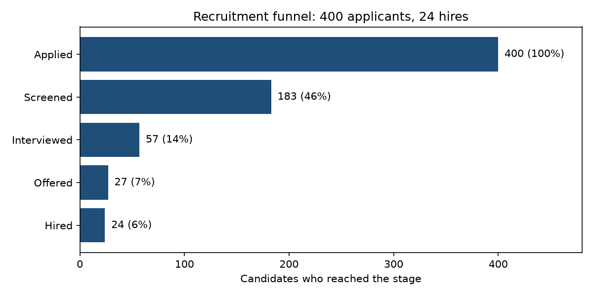
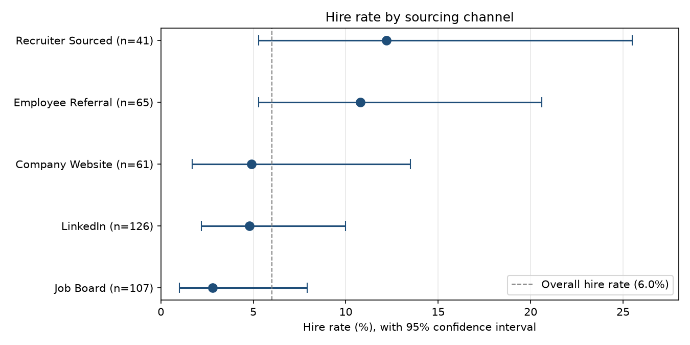

# Recruitment Funnel & Sourcing Analytics in Python

Where do candidates drop out of the hiring funnel, and which sourcing channels deliver hires? This project answers both questions with pandas, then asks a harder one: **how much can this data really tell us?** Confidence intervals and significance tests separate real differences between channels from small-sample noise.

> **Data note:** the dataset is synthetic (400 candidates, 6 departments, 5 sourcing channels). The findings describe this dataset only. They are not results from a real employer.

## Key findings

- **The funnel narrows sharply.** Of 400 applicants, 183 (46%) reached screening, 57 (14%) were interviewed, 27 (7%) received an offer and 24 (6%) were hired.
- **Headline hire rates differ a lot by channel.** Recruiter Sourced was highest at 12.2% (5 hires from 41 applicants), then Employee Referral at 10.8% (7 from 65). Job Board was lowest at 2.8% (3 from 107).
- **But the ranges are wide and overlap.** 95% Wilson confidence intervals run from 5.3% to 25.5% for Recruiter Sourced and from 5.3% to 20.6% for Employee Referral. Fisher's exact test finds no detectable difference between those two channels (p = 1.0).
- **No channel pair survives correction for multiple testing.** Two of the 10 pairwise comparisons looked significant on their own (Job Board vs Recruiter Sourced, p = 0.038; Employee Referral vs Job Board, p = 0.043). After a Bonferroni correction for 10 tests they do not (adjusted p = 0.375 and 0.430).
- **What this means:** with only 3 to 7 hires per channel, channel decisions should not rest on headline hire rates alone. More applicant volume per channel is needed before a ranking can be trusted.

## Charts





## Approach

1. **Load and validate** the data: 400 rows, no duplicate candidate IDs, and `StageDate` blank only for the 217 candidates who never got past Applied.
2. **Rebuild the funnel** from `StageOrder`. Each row records the furthest stage a candidate reached, so "reached at least stage *k*" means `StageOrder >= k`.
3. **Calculate hire rate by channel** with `groupby`. The headline rates match those in my Power BI version of this analysis.
4. **Quantify uncertainty** with 95% Wilson confidence intervals (SciPy).
5. **Test differences** between channels with Fisher's exact test, then run all 10 pairwise comparisons and apply a Bonferroni correction.
6. **Chart** the results with Matplotlib.

## Data

One sheet, `Candidates`, with one row per candidate recording the furthest stage reached.

| Column | Description |
|---|---|
| `CandidateID` | Unique candidate identifier |
| `Department` | One of 6 departments |
| `JobRole` | One of 15 job roles |
| `SourceChannel` | Recruiter Sourced, Employee Referral, Company Website, LinkedIn or Job Board |
| `ApplicationDate` | Date of application (Nov 2025 to Jul 2026) |
| `StageReached` | Furthest stage: Applied, Screened, Interviewed, Offered or Hired |
| `StageOrder` | Numeric stage order, 1 to 5 |
| `StageDate` | Date the furthest stage was reached; blank for candidates who stopped at Applied |

## Repository structure

```
├── data/
│   └── recruitment_funnel.xlsx
├── notebooks/
│   └── recruitment_funnel_analysis.ipynb
├── images/
│   ├── funnel.png
│   └── hire_rate_by_channel.png
├── requirements.txt
└── README.md
```

## How to run

```bash
pip install -r requirements.txt
```

Open `notebooks/recruitment_funnel_analysis.ipynb` in VS Code or Jupyter and run all cells. The notebook reads `data/recruitment_funnel.xlsx` and saves its charts to `images/`.

## Limitations

- The data is synthetic, so the patterns say nothing about any real organization.
- Counts are small (3 to 7 hires per channel), which is why the confidence intervals are wide.
- The 10 pairwise tests are exploratory. A formal ranking of channels would need more data per channel.

## Related work

The same dataset is explored as an interactive dashboard in Power BI: [HR Recruitment Funnel & Sourcing Analytics Dashboard](https://github.com/josephomusitia5/HR-Recruitment-Funnel-Sourcing-Analytics). This repository adds the statistical layer: confidence intervals, significance tests and a multiple-testing correction.

## Built with

Python, pandas, SciPy, Matplotlib, Jupyter (VS Code)

## Author

Joseph Omusitia | [LinkedIn](https://www.linkedin.com/in/joseph-omusitia-18138a379)
